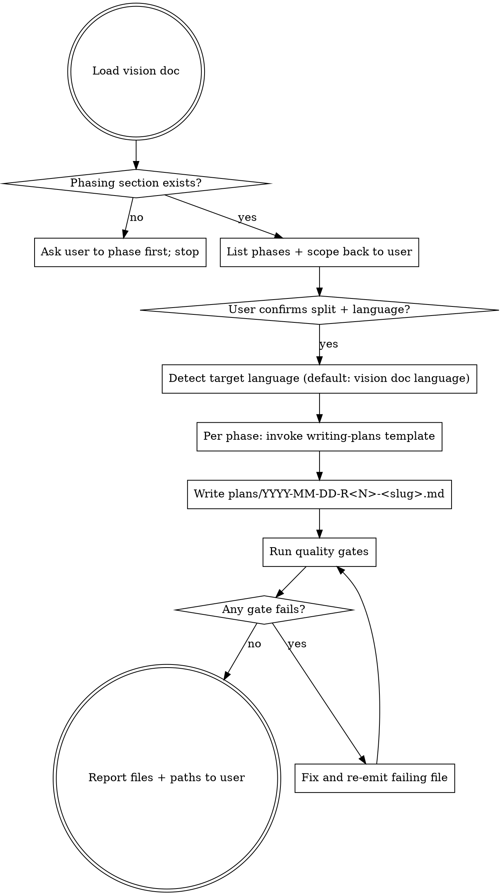

# Phased release decomposition mode

## Overview

Takes one vision/roadmap doc with phased releases. Produces N task-by-task implementation files (one per phase) in `superpowers:writing-plans` format. Each generated file mandates TDD via `superpowers:test-driven-development` and delegates execution to `superpowers:executing-plans` or `superpowers:subagent-driven-development`.

**Core principle:** Vision doc stays thin (≤200 lines). Per-release files own the detail. Combined files cause R1-scope-balloon — the exact failure mode the source plan flagged as Top-5 risk.

## When to Use

Input doc must have:
- Explicit phasing section (R1.0/R1.1/R2/R3; MVP/v1/v2; Alpha/Beta/GA)
- Per-phase scope at bullet level (not task level)
- "KPI per release" or "Done criteria per phase" or equivalent
- Intent to execute each phase as separate workstream

**Do NOT use when:**
- Single-phase project → invoke `superpowers:writing-plans` directly
- No phasing yet → invoke `superpowers:brainstorming` to phase first
- Phases not parallel-shape ("research" then "decide") → no fixed task lists yet
- Vision doc has unresolved Open Questions critical to scope → resolve first, do not paper over

## REQUIRED SUB-SKILLS

- **Per output file:** `superpowers:writing-plans` formats each release-plan
- **Generated plans declare:** `superpowers:test-driven-development` (mandatory) + one of `superpowers:executing-plans` / `superpowers:subagent-driven-development`
- **Generated plans recommend:** `superpowers:requesting-code-review` per PR

## Workflow



## Output File Template

```markdown
# <Release name> Implementation Plan

> **For agentic workers:** REQUIRED SUB-SKILL: Use `superpowers:subagent-driven-development` (recommended) or `superpowers:executing-plans` to implement this plan task-by-task. Steps use checkbox (`- [ ]`) syntax for tracking. Apply `superpowers:test-driven-development` strictly — no implementation code before a failing test exists. Apply `superpowers:requesting-code-review` to every PR.

**Goal:** <one-sentence from vision doc, no embellishment>

**Architecture:** <2–4 sentences pulled from vision doc>

**Tech Stack:** <pinned versions; lockfile commitment>

**Prerequisites:** <prior releases that must be complete>

---

## File Structure (additions only)

```
<tree of new files this release adds>
```

---

## Task <N>: <name>

**Files:**
- Create: <absolute or repo-relative paths>
- Modify: <paths>

- [ ] **Step 1:** <setup / scaffold>

- [ ] **Step 2:** Failing test
<test code that compiles and runs but fails>

- [ ] **Step 3:** Run, expect FAIL with <specific error>.

- [ ] **Step 4:** Implement
<smallest code that makes Step 2 pass>

- [ ] **Step 5:** Re-run; PASS.

- [ ] **Step 6:** Commit
\`\`\`bash
git add <paths>
git commit -m "<conventional commit subject>"
\`\`\`

---

(repeat Tasks 1..M)

---

## Done criteria for <release>

<bullet list mirroring vision doc's KPI for this phase>

## Skipped in <release> (deferred to <next phase> or out of scope)

<bullet list>

## Expansion checklist (before execution)

For each task:
1. <pre-flight check specific to this release>
2. <e.g. "Re-read current Tolk + Acton docs; pin versions in lockfile">
3. <reviewer / security / compliance reminder>
```

## Quality Gates (run after each generated file)

| Gate | Method | On fail |
|------|--------|---------|
| One file per release | Count files in `plans/` matches phases in vision doc | Missing file → emit; extra file → flag |
| Same language across all files | Detect language of vision doc; sample 3 paragraphs per file | Re-emit file in correct language |
| TDD scaffolding per task | Every code-writing task has a "Failing test" step before "Implement" step | Re-emit task with Red-Green-Refactor block |
| REQUIRED SUB-SKILL header | First non-title block of every file | Insert header, re-emit |
| File naming | `YYYY-MM-DD-R<num>(\.<sub>)?-<kebab-slug>.md` | Rename |
| Commit step per task | Every task ends with `git add` + `git commit -m "..."` block | Append commit step |
| Cross-release references valid | Mentions of "see R1.1 Task 3" resolve to existing tasks | Replace with valid pointer or remove |
| Vision doc untouched | Diff vision doc path before vs after | Revert any edits |

## Common Mistakes

| Mistake | Fix |
|---------|-----|
| Language drift (EN + RU mix) | Detect language ONCE from vision doc; reject any drifting output before write |
| Bloated single-file output | Hard split per phase. No multi-phase file under any pretext. |
| Task without failing-test step | Reject task. Exceptions only match `superpowers:test-driven-development` exceptions (generated wrappers, pure DTOs, migration SQL, one-off seed scripts) |
| Vague tasks ("set up auth") | Reject. Tasks list concrete files, code, and pass/fail criteria |
| Auto-invented phases | Phases come from vision doc only. If absent, stop and ask user. |
| Auto-numbered tasks across files | Restart task numbering per file. Cross-file references use "R1.1 Task 3" format. |
| Embedded narrative ("we decided to...") | Strip. Plans are executable, not historical |
| Missing "Skipped" / "Done criteria" sections | Re-emit with both sections — they prevent scope creep |

## Red Flags — STOP and clarify with user

- Vision doc has no Phasing/Releases section → ask user to phase first; do not invent
- User mid-stream switches language → ask which language the WHOLE deliverable uses
- "Just one combined file is fine" → push back; combined file blocks subagent-driven-development workflow and re-introduces R1-scope-balloon
- Vision doc has unresolved Open Questions affecting scope → enumerate them; ask user to resolve or explicitly mark `TBD` per affected task
- A phase has no concrete deliverables (only goals) → ask user for at least 3 concrete artifacts (files, endpoints, tests) before generating tasks

## Anti-Patterns

- ❌ Combining R1.0 + R1.1 because "they're small" — they grow under execution
- ❌ Skipping the failing-test step for "config-only" tasks — config still asserts via integration test against fresh state
- ❌ Writing English plans from a Russian vision doc — language consistency is mandatory
- ❌ Generating tasks Claude has not verified against current library versions — pin versions and link to docs
- ❌ Suppressing "Skipped" section because "scope is obvious" — it is not; future-you and reviewers need the boundary

## File Layout

Output:
- Files into `plans/` (create if missing) at the same repo level as the vision doc
- Filename: `YYYY-MM-DD-R<num>-<kebab-slug>.md` (today's date for all files in one run)
- One file per release phase, exactly
- Vision doc stays at original path, untouched

## Verification After Run

Report to user:
1. List of generated files with paths
2. Count of tasks per file
3. Language detected
4. Any Red Flags raised
5. Suggested next step: `superpowers:executing-plans` on the earliest-priority file
